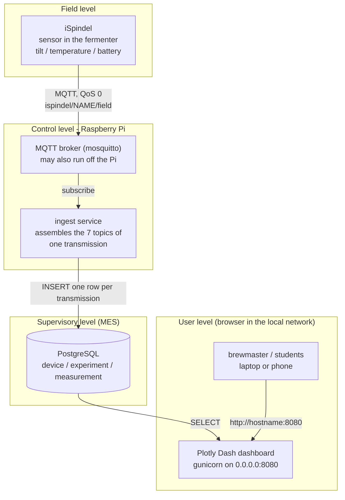
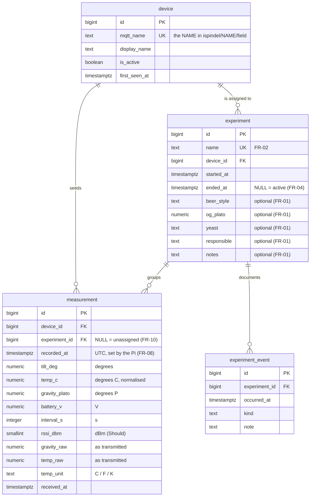

# Concept - iSpindel Fermentation Monitor (D1)

ZHAW *Digital Food Processing HS26 / AD24* - fermentation monitoring with iSpindel (field data),
Raspberry Pi (acquisition + storage + web server) and a web dashboard for brewmasters and
students. This is the 1-2 page concept deliverable: architecture with the levels of the
automation pyramid, data model, technology choice with justification, and assumptions.

## 1. Architecture and the automation pyramid

| Level | Component | Why it belongs there |
| --- | --- | --- |
| Field | iSpindel | sensor that provides raw process data (tilt angle -> gravity, temperature, battery) |
| Control | Raspberry Pi: mosquitto + ingest service | receives and processes the data locally; **monitoring only**, no actuators - so this level is limited to data acquisition |
| Supervisory (MES) | PostgreSQL with device / experiment / measurement | structured storage and assignment of measurements to batches - a simplified MES precursor |
| Enterprise (ERP) | - | out of scope (batch management / QA integration is a possible later step) |

## 2. Data model

Constraints that carry requirements:

* `experiment.name UNIQUE` -> FR-02 (duplicate names rejected by the database itself)
* `EXCLUDE USING gist (device_id, tstzrange(started_at, coalesce(ended_at,'infinity')))` ->
  FR-03 / FR-09: one iSpindel can never be in two experiments at the same time
* `measurement UNIQUE (device_id, recorded_at)` -> FR-11: a transmission can never be stored twice
* `measurement.experiment_id` nullable -> FR-10: values without an active experiment are kept
* indexes `(experiment_id, recorded_at)` and `(device_id, recorded_at DESC)` -> the two dominant
  queries: "all measurements of experiments A and B ordered by time" and "latest value per device"

Queries/views the dashboard and the evaluation use:

| View / query | Purpose | Requirement |
| --- | --- | --- |
| `v_device_latest` | newest row per device: batch zones, battery, countdown, "no data" analysis | FR-13, FR-19 |
| `v_experiment_overview` | experiment + iSpindel + status + measurement count + optional fields | FR-05 |
| measurements of the selected experiments, ordered by time | comparison chart, optional relative axis | FR-16 - FR-18 |
| measurements of the selected experiments + time range | CSV export | FR-21, FR-22 |

## 3. Technology choice

| Layer | Choice | Alternatives considered | Why this one |
| --- | --- | --- | --- |
| Storage | **PostgreSQL 16** | SQLite, InfluxDB, MariaDB | relational batch structure (device/experiment/measurement) with foreign keys, `timestamptz` (UTC, DST-safe) and exclusion constraints that enforce "one iSpindel, one active experiment" **in the database**; SQL is what the later evaluation in Excel/Python/R expects; runs comfortably on the Pi and is a standard package on Raspberry Pi OS |
| Acquisition | **Python + paho-mqtt** as a systemd service | Node-RED, Telegraf, shell script | the ingest has to assemble seven individual messages into one row, normalise units and reconnect after broker outages - explicit code is easier to defend and to test than a flow editor, and it is the same language as the dashboard |
| Dashboard | **Plotly Dash** (+ dash-mantine-components, Tailwind CSS) | Grafana, Node-RED dashboard, Streamlit, hand-written web app | native Plotly charts (comparison chart, per-device chart) without JavaScript, callbacks in Python (the team's language), free layout with Tailwind; Grafana cannot create/edit experiments and Streamlit's rerun model fights a live view |
| Broker | **mosquitto** | public broker, HiveMQ | data stays in the local network; `deploy/pi_setup.sh` configures the listener (mosquitto 2.x listens on localhost only by default) |
| Web server | **gunicorn** under systemd | Dash development server | restart after a power failure, no interactive debugger on a `0.0.0.0` binding |
| Browser side | Tailwind CSS (CLI build, committed) | component library only, hand-written CSS | responsive utility classes for a phone in the cellar; Dash serves the compiled file from `app/assets/` |

## 4. Derived values on the batch card (FR-20)

The batch card shows three numbers that are not transmitted by the iSpindel - they are computed on
the Pi from the experiment's **original gravity (OG)** and the newest measurement, and every one of
them is written out here so a reader can check them:

| Value on the card | Formula (all gravities in °P, `sg(x) = 1 + x / (258.6 - 0.8795 * x)`) | Example: OG 15.9 °P |
| --- | --- | --- |
| `Target FG: ~x °P` | `og * (1 - expected_attenuation / 100)`, `expected_attenuation` from `config.yml` (default 80 %) | 3.2 °P |
| `Rate: x °P/24h` | `(newest gravity - gravity 24 h earlier) / hours between them * 24`; negative while the fermentation is running | about -4 °P/24 h in the middle of a batch, 0 at the end |
| `x % Atten` | `(og - fg) / og * 100` (apparent attenuation, both in °P) | 0 % at the start |
| `x % ABV` | `(sg(og) - sg(fg)) * 131.25` (the common rule of thumb on specific gravity) | 4.0 % |
| `Est. Final: x % ABV` | the same ABV formula, but with the **target FG** instead of the current one | 5.7 % |
| `Target: a–b °C` + `▲ / ▼ / ✓` | the window from `dashboard.target_temp_c` for the experiment's `beer_style` (matched case-insensitively, else `default`); the deviation is `temp - b` (°C) above, `a - temp` below | 19.0–21.0 °C, ▲ 1.1 °C |

**Why these formulas:** apparent attenuation needs no SG conversion (both values are already °P),
while ABV is only linear in the *specific gravity* difference - that is why the SG conversion is in
the ABV row and nowhere else. Both derived values are **clamped at 0**: a fermentation cannot gain
extract, and an uncalibrated device can report more °P than its own OG (the `dfp_os_01` case).
Whenever an input is missing - no running experiment (no OG), a history shorter than 24 h, no
gravity yet - the card shows `-` instead of a number, so nothing on the dashboard pretends to know
something the database does not.

## 5. Assumptions and clarifications

| # | Assumption | Consequence if wrong |
| --- | --- | --- |
| A1 | The stock firmware sends **one MQTT message per value** and **no timestamp**; the Pi's clock is the time source (NTP/chrony). | without a correct Pi clock every stored time is wrong |
| A2 | The device's calibration polynomial returns **degrees Plato** (`ingest.gravity_unit: "P"`); the raw value and the unit are stored as well. | values off by the SG -> °P conversion; already stored rows would have to be recomputed |
| A3 | The topic structure is fixed: `ispindel/<name>/<field>`; the prefix cannot be changed on the device. | a renamed/bridged broker needs an MQTT bridge or a changed ingest subscription |
| A4 | Publishing uses QoS 0 without retain: a transmission during a broker/Pi outage is **lost** and cannot be recovered. | - |
| A5 | Database, dashboard and ingest run on the Pi; the broker may run elsewhere (NFR-01 allows it). | - |
| A6 | No authentication in the local network; the dashboard is never exposed to the internet. Anybody who can publish `ispindel/<name>/...` can inject values. | - |
| A7 | All iSpindels in use can publish to the **same** broker (open point - to be clarified with the client). | the other fermentations would not appear in the dashboard (FR-15 / T-02) |
| A8 | Timestamps are stored in UTC and displayed in `Europe/Zurich` (NFR-09). | the DST change would double or skip an hour in the display |

### Open questions for the client

1. Which **two questions** should the dashboard answer for the brewmaster - is one of them a
   comparison between experiments? (needed for the presentation)
2. Do all iSpindels of the course publish to **one broker** during the fermentation phase, and to
   whose? (decisive for FR-15 / T-02)
3. What is the agreed **naming convention** for experiments so that the batches of all groups can
   be compared later?
