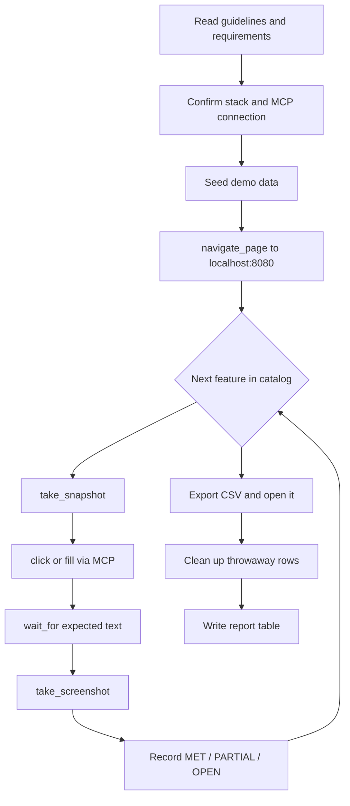

# Prompt: full UI verification of the iSpindel dashboard (chrome-devtools MCP)

> **How to use this file.** Paste everything below the line into an agent that has the
> **chrome-devtools MCP server** connected and a local stack running. The agent will read the
> project guidelines, walk **every** feature we built on the live page, look at the reference
> screenshots, click through the Dash callbacks with the MCP browser tools, and write a
> per-requirement evidence report. Nothing has to be clicked by hand.

---

## 0. Role and objective

You are an **acceptance tester** for the iSpindel fermentation monitor. Your job is to prove, on the
**running dashboard**, that every functional and non-functional requirement is met, and to leave
behind screenshot evidence for each one.

You do **not** change code. You drive the browser through the chrome-devtools MCP tools, capture
evidence, and produce a report. Work top to bottom through the feature catalog in section 6 and the
click-through scripts in section 7. Do not stop at the first failure - record it as `PARTIAL`/`OPEN`
and continue.

Target: **`http://localhost:8080`** (a local stack started with the `demo` profile).

---

## 1. Preconditions

### 1.1 The stack is running with demo data

The dashboard starts **empty**. Start the stack with the `demo` profile so there are six simulated
iSpindels and 17 batches to look at. `<engine>` is `docker` or `podman` - pick the one installed.

```bash
# macOS / Linux / Raspberry Pi (bash)
docker compose --profile demo up -d --build      # or: podman compose --profile demo up -d --build

# Windows (PowerShell)
docker compose --profile demo up -d --build      # or: podman compose --profile demo up -d --build
```

If the stack is already up, seed the demo fleet instead of rebuilding:

```bash
docker compose exec -T dashboard python tools/simulate.py --demo --until-now
```

Confirm the three containers are healthy and the dashboard answers:

```bash
docker compose ps
curl -s -o /dev/null -w '%{http_code}\n' http://localhost:8080/     # expect 200
```

Everything seeded this way carries the **`SIM_`** prefix. Remove it again with:

```bash
docker compose exec -T dashboard python tools/simulate.py --delete
```

### 1.2 The chrome-devtools MCP server is connected

The agent must have the chrome-devtools MCP server available. A typical configuration:

```json
{
  "mcpServers": {
    "chrome-devtools": {
      "command": "npx",
      "args": ["-y", "chrome-devtools-mcp@latest"]
    }
  }
}
```

> **Tool names.** This prompt uses the canonical chrome-devtools MCP tool names
> (`navigate_page`, `take_snapshot`, `click`, `fill`, `take_screenshot`, `wait_for`,
> `evaluate_script`, `list_console_messages`, `list_network_requests`, `new_page`, `list_pages`,
> `select_page`, `close_page`, `press_key`, `hover`). If your build names them differently, use the
> equivalent tool - the intent is always: navigate, snapshot, click/fill, wait, screenshot.

### 1.3 Optional: the self-tests (server-side, no browser)

These run inside the container and prove the same requirements without a browser. Run them first as
a baseline; the browser walkthrough then confirms the **UI** really exposes them.

```bash
docker compose exec -T dashboard python tools/check_requirements.py
docker compose exec -T dashboard python tools/ui_test.py
docker compose exec -T dashboard python tools/fr19_test.py
```

---

## 2. Required reading (do this before touching the browser)

Read these so you know what "correct" means. The requirement IDs (`FR-01`…`FR-22`, `NFR-01`…`NFR-09`)
come from the assignment and are named in the code comments.

| What | Where | Why |
| --- | --- | --- |
| Project guidelines (assignment) | [`Project_Guidlines.pdf`](../Project_Guidlines.pdf) | the client's brief. It is a **scanned** PDF (images, no text layer) - read it visually. |
| Requirements specification | [`docs/spec/03-requirements.md`](../docs/spec/03-requirements.md) | every FR/NFR with its priority and acceptance criterion. |
| Acceptance checklist | [`presentation/requirements-checklist.md`](../presentation/requirements-checklist.md) | the fill-in sheet the client uses; your report mirrors it. |
| Screenshot index | [`presentation/screenshots/INDEX.md`](../presentation/screenshots/INDEX.md) | what each reference screenshot shows and which requirement it proves. |
| Project rules | [`.clinerules/project.md`](../.clinerules/project.md) | non-negotiable rules (config in `config.yml`, requirement ids in comments, …). |
| Memory bank | [`.clinerules/memory_bank.md`](../.clinerules/memory_bank.md) | how the project documents itself. |
| Dashboard source | [`main.py`](../main.py) | the single source of truth for every element id and label (section 5). |

---

## 3. The verification loop



---

## 4. chrome-devtools MCP interaction protocol

Follow these rules for **every** interaction - they are what makes the Dash callbacks behave.

1. **Snapshot before you click.** Call `take_snapshot` and use the `uid` it returns. Never guess a
   selector; the DOM is rebuilt by Dash.
2. **The page auto-refreshes every 15 s** (`dashboard.refresh_ms`). The device grid and the tables
   are re-rendered on each tick, so a `uid` from an old snapshot can be stale. Re-snapshot right
   before each click, and again after a refresh.
3. **Wait for the callback, not a fixed sleep.** After a click that opens a dialog or writes data,
   call `wait_for` on the expected text (e.g. the dialog title `Set up experiment`, or the toast
   `started (FR-01)`) before you screenshot.
4. **Toasts are transient.** The top-right notice (`#msg`) fades within a few seconds and only fires
   on an action. Screenshot **immediately** after the action that triggers it.
5. **The dialogs cannot self-close.** `exp-modal` and `broker-modal` have no X, no click-outside and
   no Esc. Close them with the **Cancel** / **Close** button only.
6. **The chart is a Plotly canvas.** Do not read values from pixels. Read the `#chart-readout` div
   (the "upper legend") or use `evaluate_script` to read the DOM text.
7. **Check the console.** After each flow, call `list_console_messages` and record any error. A
   silent `ID not found in layout` means a callback is dead in the browser.
8. **One screenshot per feature**, named `<FR-id>_<slug>.png`, into
   `presentation/screenshots/agent-run/`. For popups, also save the `take_snapshot` text next to it.

---

## 5. Element selector cheat sheet

Every id below is rendered by [`main.py`](../main.py). Use the visible **label** to find the element
in a snapshot; the id is what the callback matches on.

### Device cards (FR-13, FR-19, FR-20)

| Element | Id / pattern | Notes |
| --- | --- | --- |
| Card (collapsible) | `{"type":"card","device":<id>,"slot":<slot>}` | click the summary to expand |
| Set up experiment | `{"type":"setup-btn","device":<id>,"slot":<slot>}` | shown when **no** experiment runs |
| End experiment | `{"type":"end-btn","device":<id>,"slot":<slot>}` | red, shown while an experiment runs |
| Times line | `{"type":"times","device":<id>,"slot":<slot>}` | `last: dd.mm. HH:MM:SS (Ns ago) · upcoming: …` |
| Status dot | inside the card header | green = healthy, red = stale / low battery (FR-19) |
| Zones | `Gravity °P \| °P 24h`, `Temperature`, `Attenuation & ABV` | FR-20 derived values |

### Experiment panel (FR-05, FR-12, FR-15)

| Element | Id | Notes |
| --- | --- | --- |
| Tabs | `exp-tabs` | values `running`, `completed`, `devices` |
| Tab labels | `exp-tab-running`, `exp-tab-completed`, `exp-tab-devices` | carry the counts |
| Panels | `exp-running`, `exp-completed`, `devices-table` | |
| Row actions | `{"type":"row-btn","exp":<id>,"mode":…}` | modes: `chart`, `edit`, `delete`, `end`, `csv` |
| Device actions | `{"type":"dev-btn","device":<id>,"mode":…}` | modes: `settings`, `delete` |
| Broker list (inline) | `broker-inline` | read-only |
| Open broker dialog | `broker-open` | button "MQTT brokers" |

### Experiment / device dialog (FR-01…FR-06, FR-12)

| Element | Id | Notes |
| --- | --- | --- |
| Modal | `exp-modal` | title varies: Set up / Edit / Delete / End / Device settings / Delete iSpindel |
| Message | `modal-msg` | validation errors appear here |
| Experiment form | `exp-form` | fields below |
| Name | `new-name` | required (FR-01) |
| Start | `new-start` | empty = now, else `2026-11-12T16:30` |
| Beer style | `new-style` | optional |
| Original gravity °P | `new-og` | optional, number |
| Yeast | `new-yeast` | optional |
| Responsible | `new-responsible` | optional |
| Notes | `new-notes` | optional |
| Measurement table | `exp-measurements` | edit mode only |
| Note input (per row) | `{"type":"meas-input","meas":<id>}` | FR-06 |
| Save note | `{"type":"meas-save","meas":<id>}` | FR-06 |
| Delete measurement | `{"type":"meas-del","meas":<id>}` | FR-06 |
| Device form | `dev-form` | FR-12 |
| Display name | `dev-name` | FR-12 |
| In use | `dev-active` | checklist, FR-12 |
| Cancel | `exp-cancel` | closes the dialog |
| Submit | `exp-submit` | label varies by mode |

### Broker dialog (FR-15)

| Element | Id | Notes |
| --- | --- | --- |
| Modal | `broker-modal` | |
| List | `broker-list` | own broker first (read-only, from `config.yml`) |
| Form | `broker-form` | |
| Label / Host / Port / Prefix / User / Password | `broker-label`, `broker-host`, `broker-port`, `broker-prefix`, `broker-user`, `broker-password` | |
| Enabled | `broker-enabled` | checklist |
| Row actions | `{"type":"broker-btn","broker":<id>,"mode":…}` | modes: `toggle`, `edit`, `delete` |
| Close / Add / Save | `broker-cancel`, `broker-add`, `broker-submit` | |

### Comparison chart (FR-14, FR-16, FR-17, FR-18)

| Element | Id | Notes |
| --- | --- | --- |
| Graph | `chart` | Plotly canvas |
| Readout | `chart-readout` | hover values, above the figure |
| Show | `chart-series` | `both` / `gravity` / `temperature` |
| Time axis | `relative` | `abs` / `rel` (hours since start) |
| Time range | `range` | `all` / `7d` / `24h` |
| Download target | `download` | FR-21 CSV |

### Notices

| Element | Id | Notes |
| --- | --- | --- |
| Toast | `msg` | top-right, transient (FR-01/FR-04/FR-06/FR-21) |

---

## 6. Feature catalog

One row per requirement. "Ref shot" is the reference screenshot in
[`presentation/screenshots/`](../presentation/screenshots/) that shows the expected state.

### 6.1 Experiment management (FR-01 - FR-06)

| ID | Prio | What to prove | Where | Expected | Ref shot |
| --- | --- | --- | --- | --- | --- |
| FR-01 | M | Create + start an experiment from the dashboard | card `setup-btn` → dialog → `new-name` (+ optional) → `exp-submit` | toast `experiment '…' started (FR-01)`; card header shows the experiment name; red `end-btn` appears | `07_popup_setup_experiment.png` |
| FR-02 | M | Duplicate name rejected | create with an existing name | dialog stays open, red `'…' already exists - names must be unique (FR-02)` | - |
| FR-03 | M | One iSpindel per experiment, at most one active | a running card has **no** `setup-btn`; a second create is refused | `this iSpindel already runs an experiment - end it first (FR-03)` | - |
| FR-04 | M | End an active experiment | card `end-btn` (or row `end`) → dialog "End experiment" → `exp-submit` | read-only fields + amber warning; toast `… ended - new measurements are no longer assigned to it (FR-04)` | not captured (see INDEX) |
| FR-05 | M | Overview of all experiments | tabs `Running (n)` / `Completed (n)` | columns Name, iSpindel, Start Timestamp, Status, Measurements, Beer style, OG °P, Yeast, Responsible, End Timestamp, Actions | `02_tab_completed.png` |
| FR-06 | S | Edit fields + record events | row `edit` → dialog "Edit experiment" prefilled + measurement table | change fields → `Save changes` → toast `… updated (FR-06)`; note → `note saved (FR-06)`; delete row → `measurement removed (FR-06)` | `10_popup_edit_experiment.png` |

### 6.2 Data acquisition and storage (FR-07 - FR-12)

| ID | Prio | What to prove | Where | Expected | Ref shot |
| --- | --- | --- | --- | --- | --- |
| FR-07 | M | All iSpindels received via MQTT automatically | the overview shows one card per active device | six `SIM_` cards after seeding | `00_dashboard_overview.png` |
| FR-08 | M | Every measurement stored with the minimum fields | expand a card; open the edit dialog's measurement table | tilt, temp, gravity, battery, interval, RSSI all visible | `06_device_card_expanded.png` |
| FR-09 | M | Auto-assigned to the active experiment | a running experiment's chart/table fills with its device's data | measurements appear in the correct experiment | `03_chart_comparison_2experiments.png` |
| FR-10 | S | Unassigned measurements kept | a device with no experiment still shows a card | card says `no experiment yet` and still shows data | `01_overview_top.png` |
| FR-11 | M | No fixed interval, no duplicates | card footer `interval N s`; measurement table | one row per transmission | `06_device_card_expanded.png` |
| FR-12 | M | Linked entities; device master data | tab `Devices (n)`; `dev-btn` settings / delete | table with Name (MQTT topic), Broker (address), Display name, Status, First seen, Last measurement, Interval, Measurements, Actions | `05_tab_devices_brokers.png`, `12_popup_device_settings.png`, `13_popup_delete_ispindel_confirm.png` |

### 6.3 Dashboard and visualisation (FR-13 - FR-20)

| ID | Prio | What to prove | Where | Expected | Ref shot |
| --- | --- | --- | --- | --- | --- |
| FR-13 | M | Latest values + time of last measurement | card header + footer | gravity °P, temp °C, battery %; `last: dd.mm. HH:MM:SS (Ns ago)` | `06_device_card_expanded.png` |
| FR-14 | M | Chart auto-updates within 60 s, no reload | leave the page open, watch the tick | the chart refreshes every 15 s (`refresh_ms`) | `00_dashboard_overview.png` |
| FR-15 | M | All iSpindels at once, distinguishable | overview + comparison chart legend | one card per device, distinct colours/names | `05_tab_devices_brokers.png` |
| FR-16 | M | Any experiment incl. completed, selectable range | row `chart` icon; `range` radio | completed experiment shown over its duration; range changes the chart | `03b_chart_comparison_absolute.png` |
| FR-17 | M | Two experiments overlaid | row `chart` on two rows | both series in one chart with a legend | `03_chart_comparison_2experiments.png` |
| FR-18 | S | Relative time axis | `relative` radio → "hours since start" | both experiments start at 0 h | `04_chart_relative_time_axis.png` |
| FR-19 | S | Warning: silent > 3 intervals or low battery | card status dot; expand for the reason | red dot + text `no data for … min` / `battery low: … V` | `06_device_card_expanded.png` |
| FR-20 | C | Derived values | card zones | attenuation %, ABV %, gravity drop per 24 h, target FG, target temp window | `06_device_card_expanded.png` |

### 6.4 Data access and export (FR-21 - FR-22)

| ID | Prio | What to prove | Where | Expected | Ref shot |
| --- | --- | --- | --- | --- | --- |
| FR-21 | M | CSV of a selected experiment | row `csv` icon | downloads `<experiment>.csv`; toast `exported N measurements …`; opens in Excel | not captured (downloads a file) |
| FR-22 | S | Several experiments / a time range in one file | set `range`, export | file contains exactly the selected data | - |

### 6.5 Non-functional requirements (NFR-01 - NFR-09)

| ID | Prio | What to prove | How (UI where possible) | Ref shot |
| --- | --- | --- | --- | --- |
| NFR-01 | M | App, DB, web server on the Pi | not UI-testable locally - note it, cite the compose stack | - |
| NFR-02 | M | Reachable in the LAN via `http://hostname:port` | open via the machine's LAN address, not `localhost` | - |
| NFR-03 | M | Auto-start after restart | note the systemd unit `deploy/systemd/ispindel.service` | - |
| NFR-04 | M | No data loss + backup | note `deploy/backup.sh`; the `pgdata` volume survives `down` | - |
| NFR-05 | M | Operable without programming, UI in English | the whole walkthrough demonstrates it; every label is English | `00_dashboard_overview.png` |
| NFR-06 | S | Usable on a smartphone | emulate a 390 px viewport; the chart drops its legend | `14_mobile_responsive.png` |
| NFR-07 | S | Complete experiment < 5 s | measure the load time with `evaluate_script` (`performance.timing`) | - |
| NFR-08 | M | README + settings in a config file | note [`README.md`](../README.md) and [`config.yml`](../config.yml) | - |
| NFR-09 | S | UTC stored, Europe/Zurich displayed | timestamps on the page are local time; the CSV has both columns | - |

---

## 7. Click-through scripts

Run these in order. Each step names the MCP tool to use. Re-snapshot before every click.

### 7.1 Open the dashboard (FR-05, FR-13, FR-15)

1. `navigate_page` → `http://localhost:8080`.
2. `wait_for` the text `Running (` (the tab label).
3. `take_snapshot`; confirm one card per `SIM_` device and the three tabs.
4. `take_screenshot` → `presentation/screenshots/agent-run/00_overview.png`.

### 7.2 Expand a device card (FR-08, FR-13, FR-19, FR-20)

1. `take_snapshot`; `click` the summary of a card (the device name).
2. `wait_for` the text `Attenuation & ABV`.
3. `take_snapshot`; read the three zones, the footer `tilt … RSSI … interval …` and the times line.
4. `take_screenshot` → `06_device_card_expanded.png`.

### 7.3 Create an experiment (FR-01, FR-02, FR-03)

1. On a card **without** a running experiment, `click` **Set up experiment**.
2. `wait_for` the dialog title `Set up experiment`.
3. `fill` `new-name` with `zz_agent_<timestamp>`; optionally fill `new-style`, `new-og`, `new-yeast`,
   `new-responsible`, `new-notes`.
4. `click` **Start experiment** (`exp-submit`).
5. `wait_for` the toast `started (FR-01)`; `take_screenshot` immediately → `FR-01_create.png`.
6. **FR-02:** repeat on another card with the **same** name; `wait_for` `already exists`; screenshot
   → `FR-02_duplicate.png`; `click` **Cancel**.
7. **FR-03:** the card that now runs an experiment shows **End experiment**, not **Set up
   experiment**; screenshot → `FR-03_one_active.png`.

### 7.4 Edit an experiment and its measurements (FR-06)

1. Go to the `Completed` tab; `click` the row `edit` icon (pencil).
2. `wait_for` the title `Edit experiment`; `take_snapshot`; confirm the fields are prefilled and the
   measurement table is shown.
3. `take_screenshot` → `10_popup_edit_experiment.png`.
4. Change `new-yeast`; `click` **Save changes**; `wait_for` `updated (FR-06)`.
5. Re-open the edit dialog; type a note into a `meas-input`; `click` its `meas-save`; `wait_for`
   `note saved (FR-06)`.
6. `click` a `meas-del`; `wait_for` `measurement removed (FR-06)`.

### 7.5 End an experiment (FR-04)

1. On the card that runs `zz_agent_…`, `click` **End experiment**.
2. `wait_for` the title `End experiment`; confirm the fields are read-only and the amber warning is
   shown; `take_screenshot` → `FR-04_end_confirm.png`.
3. `click` **End experiment** (`exp-submit`); `wait_for` `ended - new measurements are no longer
   assigned`; screenshot the toast → `FR-04_ended.png`.

### 7.6 Comparison chart (FR-16, FR-17, FR-18)

1. On the `Completed` tab, `click` the `chart` icon of two rows; `wait_for` the legend to show two
   names.
2. `take_screenshot` → `03_chart_comparison_2experiments.png`.
3. `click` the `relative` radio "hours since start"; `take_screenshot` →
   `04_chart_relative_time_axis.png`.
4. `click` the `range` radio "last 24 h"; `take_screenshot` → `FR-16_range_24h.png`.
5. `hover` the chart; read `#chart-readout`; screenshot → `FR-14_readout.png`.

### 7.7 Devices tab and device settings (FR-12)

1. `click` the `Devices (n)` tab; `wait_for` the header `Name (MQTT topic)`.
2. `take_screenshot` → `05_tab_devices_brokers.png`.
3. `click` a row's `settings` icon; `wait_for` the title `Device settings`; confirm the MQTT name is
   read-only; `take_screenshot` → `12_popup_device_settings.png`; `click` **Cancel**.
4. `click` a row's `delete` icon; `wait_for` the title `Delete iSpindel`; `take_screenshot` →
   `13_popup_delete_ispindel_confirm.png`; `click` **Cancel** (do **not** confirm on demo data).

### 7.8 MQTT brokers (FR-15)

1. On the `Devices` tab, `click` **MQTT brokers** (`broker-open`).
2. `wait_for` the title `MQTT brokers`; confirm the own broker is the first, read-only row.
3. `take_screenshot` → `08_popup_mqtt_brokers.png`.
4. `click` **Add broker**; `fill` `broker-label` = `zz_agent_broker`, `broker-host` = `127.0.0.1`,
   `broker-port` = `1884`; `take_screenshot` → `09_popup_add_broker_form.png`.
5. `click` **Save broker**; `wait_for` the new row; then `click` its `delete` icon and confirm to
   clean up. `click` **Close**.

### 7.9 CSV export (FR-21, FR-22)

1. On a completed row, `click` the `csv` icon.
2. `wait_for` the toast `exported … measurements`; `take_screenshot` → `FR-21_export.png`.
3. Confirm the download via `list_network_requests` (a `text/csv` response) and open the file to
   check the header:
   `experiment,ispindel,timestamp_utc,timestamp_local,tilt_deg,temperature_c,gravity_plato,battery_v,interval_s,rssi_dbm`.

### 7.10 Mobile viewport (NFR-06)

1. Emulate a 390 px wide viewport (use the MCP's viewport/emulation tool, or `evaluate_script` to
   resize if supported).
2. `navigate_page` → `http://localhost:8080`; `wait_for` the tab label.
3. `take_screenshot` → `14_mobile_responsive.png`; confirm the chart has no legend.

### 7.11 Console and performance (NFR-07)

1. `list_console_messages`; record any error (a clean run has none).
2. `evaluate_script` → `performance.timing.loadEventEnd - performance.timing.navigationStart`; record
   the load time (must be < 5000 ms).

---

## 8. Evidence rules

* Output folder: **`presentation/screenshots/agent-run/`** (create it if missing).
* File name: `<FR-id>_<slug>.png` (e.g. `FR-01_create.png`). One screenshot per feature.
* For every popup, also save the `take_snapshot` text as `<FR-id>_<slug>.txt` next to the image.
* The three cases the reference INDEX marks "not captured" are **your** job to capture:
  * **End experiment confirmation** - only appears on a running row (script 7.5).
  * **Toast** (started / ended / export) - screenshot within its lifetime (scripts 7.3, 7.5, 7.9).
  * **CSV result** - a download, not a page state; verify the file content (script 7.9).

---

## 9. Guardrails and cleanup

* **Never edit code.** This is a read/verify task. If you spot a bug, record it in the report.
* **Use throwaway names.** Any experiment you create is named `zz_agent_…`; any broker
  `zz_agent_broker`. Delete them when done (row `delete` icon, or the Devices `delete`).
* **Do not delete the `SIM_` demo data** unless the task says so. If you seeded extra rows, remove
  them with `docker compose exec -T dashboard python tools/simulate.py --delete`.
* **Do not confirm destructive dialogs on demo data** (delete iSpindel / delete broker) - open them,
  screenshot, then **Cancel**.
* **Tailwind caveat:** a class added to the Python code does nothing until `cd assets && npm run css`
  is run and the image rebuilt. You are not changing classes, but note it if the UI looks unstyled.
* **Dialogs do not self-close** (no X / outside / Esc) - always use Cancel / Close.
* **The page refreshes every 15 s** - re-snapshot before each interaction.

---

## 10. Report format

Write the result to **`presentation/screenshots/agent-run/REPORT.md`**. Mirror the client's
checklist ([`presentation/requirements-checklist.md`](../presentation/requirements-checklist.md)):
one row per requirement, a status, and the proof.

Status codes: **MET** / **PARTIAL** / **OPEN** / **N/A**.

```markdown
# UI verification report - <date> - http://localhost:8080

Stack: docker compose --profile demo (6 SIM_ devices, 17 batches)
MCP: chrome-devtools

## 3.1 Experiment management
| ID | Prio | Requirement (short) | Status | Proof |
| --- | --- | --- | --- | --- |
| FR-01 | M | Create + start an experiment | MET | agent-run/FR-01_create.png |
| FR-02 | M | Unique name rejected | MET | agent-run/FR-02_duplicate.png |
| ... | | | | |

## 3.2 Data acquisition and storage
...

## 3.3 Dashboard and visualisation
...

## 3.4 Data access and export
...

## 3.5 Non-functional requirements
...

## Console / errors
- (none) or the list of console errors

## Summary
- MET: n / PARTIAL: n / OPEN: n / N/A: n
- Blockers: ...
- Notes: ...
```

Finish with a one-paragraph summary: what passed, what is `PARTIAL`/`OPEN` and why, and any console
errors. Do not end with a question - the report is the deliverable.
